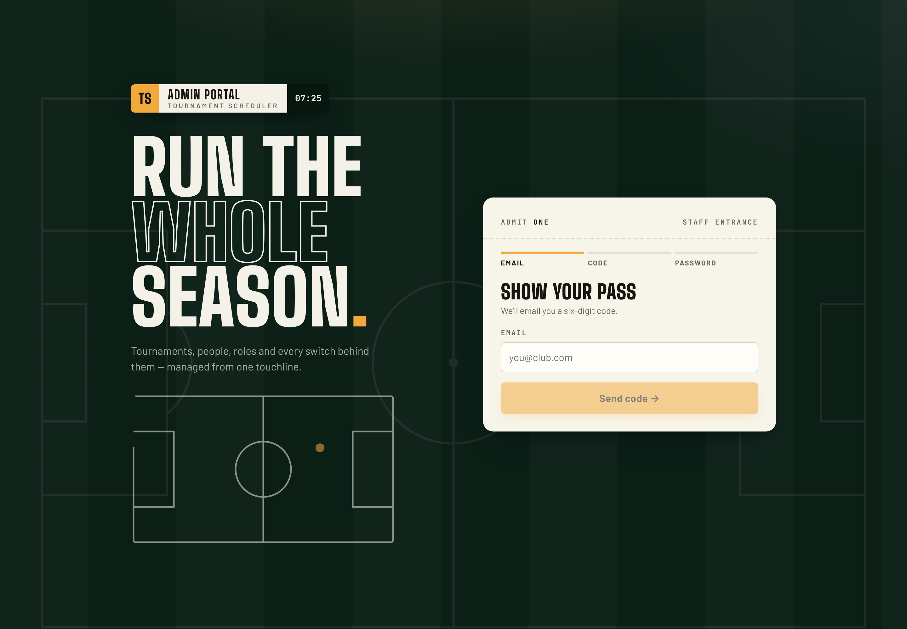
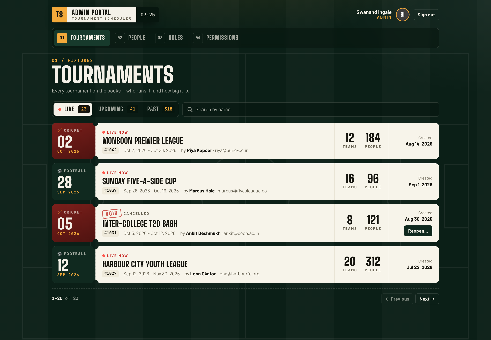
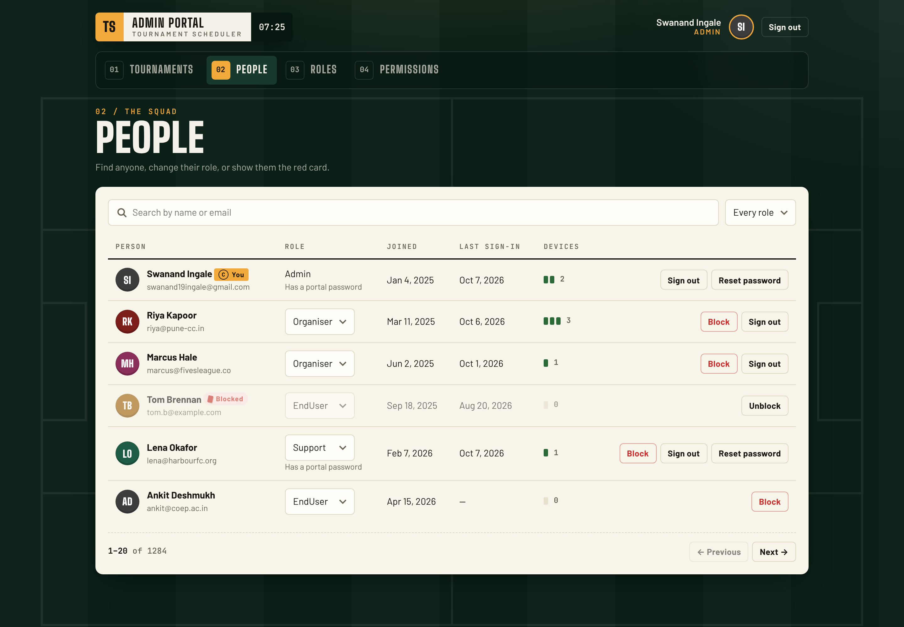
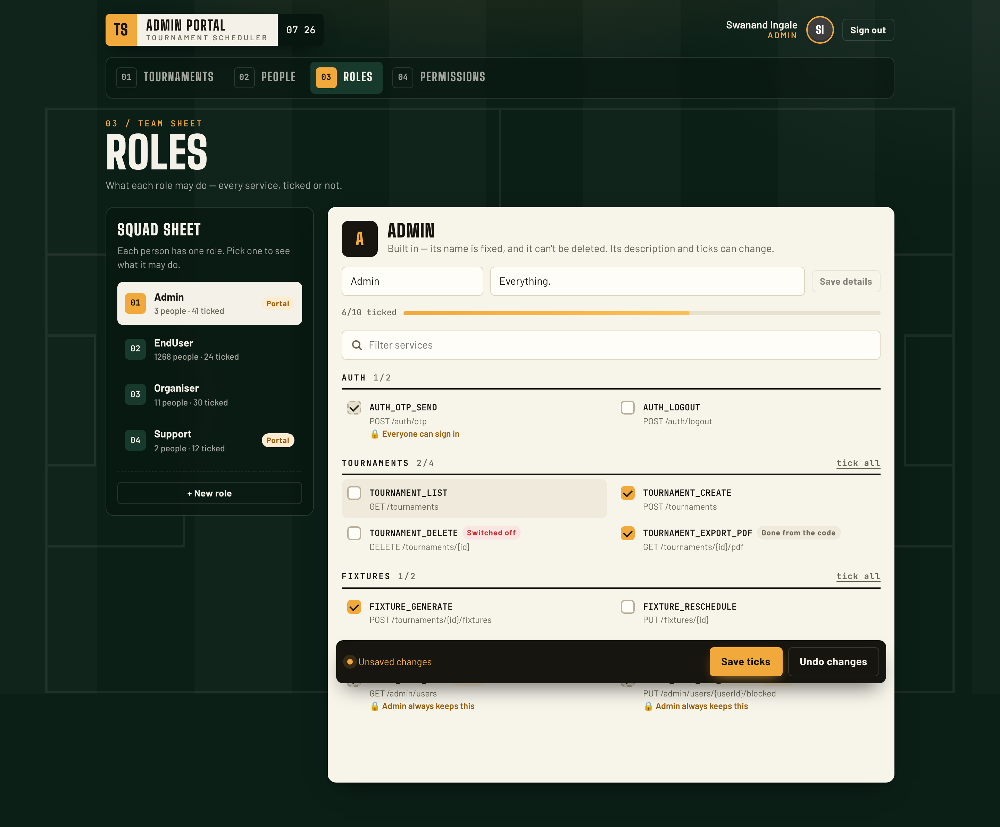
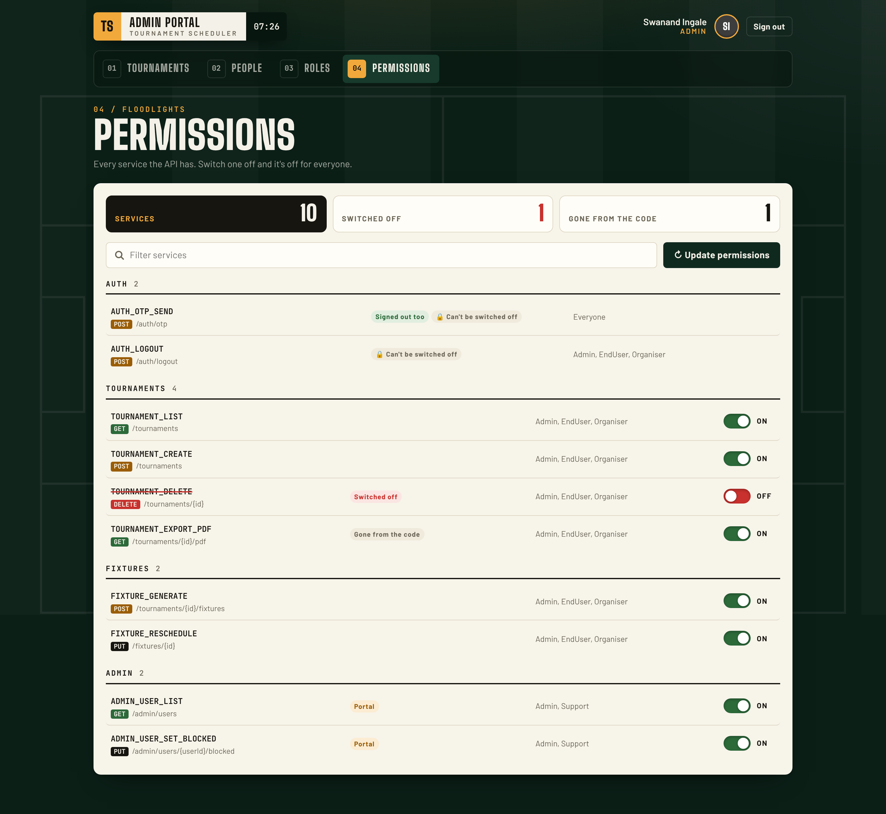
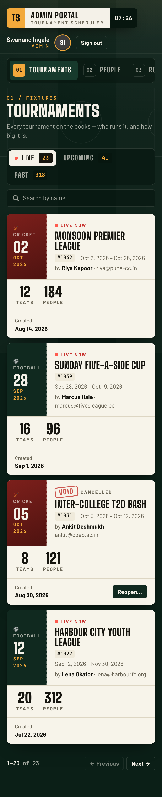

# Matchday Control — the portal's design

The portal keeps the apps' floodlit-night palette (pitch green, chalk cream, floodlight amber) and
tells it through the objects of a match day, so it reads as *this* product rather than a generic
admin template.

| Screen | Metaphor | What it does for the admin |
| --- | --- | --- |
| Header | Broadcast **scorebug** (badge · title · match clock) | Instantly recognisable brand, always-on time |
| Navigation | **Kit numbers** 01–04 | Fixed order, quick to scan, keyboard friendly |
| Tournaments | **Ticket stubs**: date on the tear-off, teams/people as scoreboard numerals, a **VOID** stamp when cancelled | The two numbers that matter read at a glance; cricket and football stubs differ in colour |
| Live / Upcoming / Past | **Scoreboard segments** with counts; Live has a pulsing on-air dot | State and volume in one control |
| People | Initials on **shirt colours**, captain's **armband** for you, a **red card** for blocked, device pips | Status is visual, not just text |
| Roles | **Squad sheet** (left) and team sheet of ticks (right), a progress meter and a floating save bar | You always see how much a role can do and whether it's saved |
| Permissions | **Floodlight switches**, tally tiles that double as filters, HTTP-method chips, struck-through IDs when off | Off-states are impossible to miss |
| Sign-in | A poster ("Run the whole season.") and an **admit-one ticket** with a 3-step progress bar and scoreboard code cells | A memorable front door; the code input is still one real, accessible input |

## Rules

- **Pitch is the room, paper is the desk.** Dark green holds navigation and summaries; cream cards hold work.
- **One amber thing per area** — the action or the selection. Red only for danger, blocked, switched off.
- **Type:** Big Shoulders Display for headings and every number; Barlow for prose; JetBrains Mono for IDs, labels and kickers.
- **Spacing** 4 · 8 · 12 · 16 · 24 · 32 · 48. **Radii** 6 controls, 12 paper, 999 pills.
- **Accessibility:** visible amber focus rings, `role="switch"`/`aria-pressed`/`aria-current` on stateful controls, every motion disabled under `prefers-reduced-motion`, layouts collapse at 860 / 820 / 760 px.

All tokens live at the top of `src/styles.css`.

